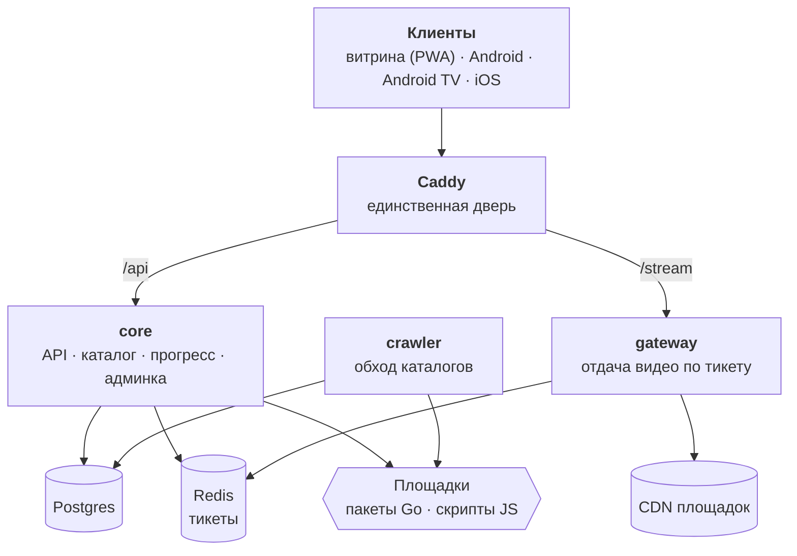

<div align="center">


# kino

**Домашний кинотеатр, где у каждого своя история просмотра.**<br>
Свой сервер для семьи и друзей — в браузере, на Android, Android TV и iOS.

[](LICENSE.md)


[Возможности](#возможности) · [Как устроено](#как-устроено) · [Быстрый старт](#быстрый-старт) · [Готовые сборки](#готовые-сборки) · [Клиенты](#клиенты) · [Площадки](#площадки) · [Свой сервер](#свой-сервер) · [Лицензия](#лицензия)

</div>

---

Одна подписка на всю семью — и общий «Продолжить смотреть», в котором чужие
сериалы, сбитые отметки и серия, которую кто-то досмотрел за тебя. **kino**
держит над источниками видео свой слой: у каждого человека — своя история,
прогресс, отметки и списки, на всех его устройствах, и никто никому их не
сбивает.

Видео kino не хранит и не раздаёт, а площадок — адаптеров к источникам — в
этом репозитории нет: ядро открыто, источники подключает владелец сервера
(см. [Площадки](#площадки) и [Ответственность](#ответственность)). Площадку
можно заменить или выключить одной строкой — история просмотров от этого не
пострадает: она привязана к тайтлу, а не к источнику.

## Возможности

### Для зрителя

- **Своё у каждого** — прогресс со слиянием устройств, «Продолжить смотреть»,
  лента «Новые серии» по тому, за чем следите, отметки «просмотрено», списки и
  папки со своим порядком, история поиска.
- **Один тайтл — много источников** — площадки склеиваются в одну карточку по
  внешним ID (Кинопоиск, IMDb, MyAnimeList) и названиям; озвучки всех площадок —
  одним списком, субтитры — отдельными файлами.
- **Плеер, который не мешает** — пропуск заставок и титров, «Дальше» на титрах,
  «Вы ещё смотрите?», выбор качества и озвучки на лету; упала площадка посреди
  серии — плеер поднимает поток с другой с того же места.
- **Телевизор** — режим ТВ в браузере с управлением пультом и нативное
  приложение для Android TV с рядами на главном экране системы
  («Продолжить просмотр», «Новые серии»).
- **Без сети** — на Android серии и сезоны скачиваются с выбором качества и
  дорожек, очередью и уведомлением; скачанное смотрится и без интернета.
- **Без сервера** — локальный движок: та же платформа целиком на телефоне, в
  режиме «на этом устройстве».

### Для владельца сервера

- **Приложения не привязаны к адресу** — человек вводит адрес вашего сервера
  при входе; регистрация по приглашениям, открытая или закрытая.
- **Админка** — пользователи, приглашения, площадки, озвучки, журнал; вход —
  пароль и второй фактор (TOTP или passkey).
- **Вход на телевизоре по коду** с телефона, список устройств и выход на любом
  из них.
- **Обновление приложения по воздуху** — Android-приложение само берёт новые
  версии с вашего сервера.
- **Приватность** — история просмотров видна только самому человеку,
  телеметрия — одна запись на просмотр ([ADR-0005](docs/adr/0005-telemetry-and-privacy.md)).

## Как устроено



Платформа — **слой пользовательского состояния**, площадки — подключаемые
источники. Отсюда два жёстких правила:

1. **Ничего не пишется обратно в API площадки.** Аккаунт площадки, если он
   нужен, — только технический ключ к видео.
2. **Прогресс ключуется на канонический ID тайтла**, а не на ID площадки —
   иначе подключение второго источника уничтожило бы историю.

Это модульный монолит из трёх деплой-юнитов, а не микросервисы: границы
проведены так, чтобы частое изменение (новая площадка) не требовало дорогого
рестарта (шлюз).

| Юнит | Зачем отдельно | Цена рестарта |
|---|---|---|
| `core` | API, каталог, прогресс, админка | просмотры переживают |
| `gateway` | отдача байт: другой профиль нагрузки; площадок не знает, видео отдаёт по тикету от `core` | **рвёт просмотры** |
| `crawler` | обход каталогов площадок: I/O, чужие API, падения | просмотры переживают |

Подробно — [docs/architecture.md](docs/architecture.md), правила слоёв —
[docs/boundaries.md](docs/boundaries.md), каждое решение с причинами —
[docs/adr/](docs/adr/).

## Быстрый старт

Понадобятся Docker с Compose и `make`:

```bash
git clone https://github.com/niazlv/kino.git
cd kino

cp .env.example .env   # задайте ADMIN_BOOTSTRAP_LOGIN, _PASSWORD и свои ключи подписи;
                       # для http://localhost — CORE_SECURE_COOKIES=false
make up                # docker compose up -d --build
```

- витрина — <http://localhost:5173>;
- админка — <http://localhost:5173/admin/>: первый администратор создаётся из
  `ADMIN_BOOTSTRAP_LOGIN` / `ADMIN_BOOTSTRAP_PASSWORD` на пустой базе, второй
  фактор (passkey или код из приложения) он настраивает при первом входе.
  После этого переменные из `.env` надо убрать;
- дальше — приглашения из админки и вход в витрине или приложениях;
- из коробки включена демо-площадка — четыре открытых фильма Blender
  Foundation (CC BY), чтобы сразу проверить каталог, плеер и приложения; свои
  источники — в разделе [Площадки](#площадки).

<details>
<summary><b>Разработка без Docker</b></summary>

```bash
make dev-db               # Postgres на :55432 + миграции
ADMIN_BOOTSTRAP_LOGIN=you ADMIN_BOOTSTRAP_PASSWORD=your-long-password make dev-core
cd web && pnpm install && pnpm dev    # витрина на :5173, /api — на core :8080
```

Пользовательский API — `http://localhost:8080/api/v1`, админка —
`http://localhost:8081/admin/`. Потеряны и приложение-аутентификатор, и
устройство с passkey — `ADMIN_RESET_TOTP=<логин>` при старте снимает TOTP,
а ключи удаляет другой администратор из карточки.

Плеер отдельно, без бэкенда — это же проверка его отделяемости:

```bash
make player-demo
```

</details>

## Готовые сборки

На странице [Releases](../../releases) — по каждому тегу `v*`, собирает
[`.github/workflows/release.yml`](.github/workflows/release.yml):

| Что | Где |
|---|---|
| серверные образы для amd64 и arm64 | `ghcr.io/niazlv/kino-core`, `kino-gateway`, `kino-crawler`, `kino-migrate`, `kino-web` |
| Android — ядро с демо-площадкой | `kino-core-<версия>.apk`, пакет `ru.sorewa.kino.core` |
| iOS без подписи — для AltStore или Sideloadly | `kino-<версия>-unsigned.ipa` |

Полная сборка с площадками — сервер и Android-приложение, которое работает и
без сервера, — в [kino-providers](https://github.com/niazlv/kino-providers).
У неё свой пакет (`ru.sorewa.kino`) и своя подпись: обе ставятся рядом.

## Клиенты

| Клиент | Где | Что нужно |
|---|---|---|
| Витрина (PWA) | [`web/apps/web`](web/apps/web) | Node, pnpm 11 — `cd web && pnpm install && pnpm build` |
| Android и Android TV | [`android/`](android) | JDK 21, Android SDK; утилита загрузки ([kinopub-downloader](https://github.com/niazlv/kinopub-downloader) рядом), ffmpeg и движок — [`build-bins.sh`](web/apps/android/tools/build-bins.sh) (NDK r27) |
| iOS | [`ios/`](ios) | Xcode, iOS 17+ |

Адрес сервера по умолчанию задаётся при сборке, в исходниках его нет. Не
задан — приложение спросит адрес при первом запуске.

```bash
cd android && ./gradlew :app:assembleDebug -PkinoUrl=http://10.0.2.2:8080   # Android: стенд с эмулятора
cp ios/Config/Local.xcconfig.example ios/Config/Local.xcconfig              # iOS: KINO_URL там
```

Подробности — [docs/android-native.md](docs/android-native.md) и
[docs/tv.md](docs/tv.md).

## Площадки

Открыто ядро — состояние просмотра, плеер, приложения и протокол площадок, —
а адаптеров к конкретным сайтам здесь нет
([ADR-0018](docs/adr/0018-core-and-providers.md)). Вместо них —
[`examples/demo`](examples/demo): пример площадки на открытых фильмах,
каталог по умолчанию, пока `PROVIDERS` не задан. Площадка описывает себя
сама — id, имя, ключи, маршрут наружу — и подключается двумя путями
([ADR-0017](docs/adr/0017-sources-one-place.md)):

- **скрипт на JS** — один файл, без сборки: его подхватывают и сервер (каталог
  `SOURCES_DIR`), и локальный движок на телефоне. Справочник автора —
  [docs/script-sources.md](docs/script-sources.md);
- **пакет на Go** — по протоколу площадок, как [`examples/demo`](examples/demo/README.md),
  и одна строка импорта, как `cmd/*/demo.go`.

Площадки автора к конкретным источникам и полная сборка с ними — отдельный
репозиторий [kino-providers](https://github.com/niazlv/kino-providers).

```bash
mkdir -p sources
go run ./cmd/sourcekit new mysite -dir sources                        # заготовка площадки-скрипта
go run ./cmd/sourcekit check sources/mysite.js -q "название" -fetch   # живая проверка контракта
SOURCES_DIR=sources go run ./cmd/sourcekit list                       # все подключённые площадки
```

Какие площадки включены, их порядок и маршрут наружу — `PROVIDERS`,
`PROVIDER_PRIORITY` и `PROVIDER_EGRESS` в `.env`. Тайтл с нескольких площадок —
одна карточка ([ADR-0008](docs/adr/0008-multiple-sources.md)).

## Свой сервер

Всё, что относится к конкретному серверу, живёт в его `.env`, а не в
исходниках:

| Что | Где |
|---|---|
| внешний адрес — от него строятся ссылки и ключи входа | `PUBLIC_URL` |
| имя сервера и режим регистрации: по приглашениям, открытая, закрытая | `SERVER_NAME`, `REGISTRATION` ([ADR-0016](docs/adr/0016-own-server.md)) |
| площадки, их ключи, порядок и маршруты наружу | `PROVIDERS`, `SOURCES_DIR`, `PROVIDER_*`, `EGRESS_ROUTES` |
| секреты подписи сессий и тикетов | раздел «секреты» в [`.env.example`](.env.example) |
| адрес сервера по умолчанию в приложениях | при сборке: `-PkinoUrl` / `KINO_URL` (Android), `Local.xcconfig` (iOS) |

Наружу платформа смотрит одной дверью — Caddy на порту 5173
([`docker-compose.yml`](docker-compose.yml)); TLS удобно держать на своём
прокси перед ним. Android-приложение обновляется по воздуху с того же
сервера: `kino.apk` и `version.json` из `deploy/apk/` отдаются по `/app/…`.

## Проверки

```bash
make test         # Go: юнит-тесты; app-слой поднимается фейками, без БД
make lint         # golangci-lint; depguard держит правила слоёв
make boundaries   # транзитивные инварианты и отделяемость плеера
cd web && pnpm test
```

`.gitleaks.toml` — правила проверки секретов: `gitleaks dir .`

## Документация

| Документ | О чём |
|---|---|
| [docs/architecture.md](docs/architecture.md) | как всё связано: поток данных, слои, версионирование |
| [docs/boundaries.md](docs/boundaries.md) | что нельзя и чем это держится |
| [docs/adr/](docs/adr/) | архитектурные решения и почему они такие |
| [docs/android-native.md](docs/android-native.md) | нативное приложение: сборка, обновления, ТВ |
| [docs/tv.md](docs/tv.md) | пульт, клавиатура, режим телевизора |
| [docs/script-sources.md](docs/script-sources.md) | как написать площадку-скрипт |
| [ADR-0018](docs/adr/0018-core-and-providers.md) | ядро и площадки: что открыто и протокол для площадок |

## Ответственность

kino — программа для личного состояния просмотра. Она не содержит, не хранит
и не распространяет фильмы, сериалы и другие произведения; права на них
принадлежат их правообладателям. Подключать ли конкретный источник, соблюдать
его условия и законы своей страны — решение и ответственность того, кто
разворачивает сервер или собирает приложение. Автор не связан с площадками,
для которых в коде есть адаптеры, и не отвечает за их содержимое.

## Лицензия

[PolyForm Noncommercial 1.0.0](LICENSE.md) — исходники открыты, но
коммерческое использование только с разрешения автора.

| Можно | Нельзя без отдельного разрешения |
|---|---|
| пользоваться, изучать, менять код | продавать доступ или подписку |
| разворачивать для себя, семьи и друзей | брать деньги за установку, хостинг, сборки |
| делиться изменениями — некоммерчески | встраивать рекламу, использовать в работе компании |

При распространении сохраняйте текст лицензии и строку `Required Notice`.
Коротко здесь — не замена тексту лицензии. За коммерческой лицензией —
к автору через [GitHub](https://github.com/niazlv).

Сторонние компоненты — Go-модули, npm-пакеты, ffmpeg в APK и
[kinopub-downloader](https://github.com/niazlv/kinopub-downloader) — остаются
под своими лицензиями.
